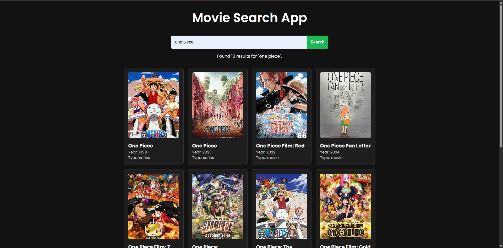
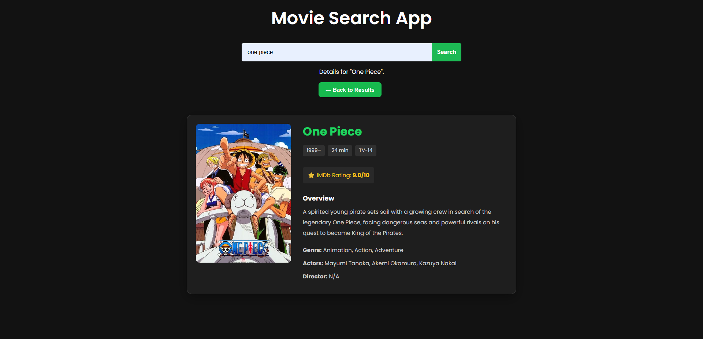

# 🎬 Movie Search App

A responsive Movie Search App built using HTML, CSS, and JavaScript. It uses the OMDb API to search for movies and display detailed information about each selected movie.
## 👨‍💻 Author

**Vishal Sharma**

GitHub: [@vishalstream-dev](https://github.com/vishalstream-dev)

## ✨ Features

- 🔍 Search movies by title
- 🎞️ Display movie posters, titles, release years, and types
- 📄 View detailed movie information
- ⭐ Display IMDb ratings
- 📝 Show movie plot, genre, actors, and director
- 🔙 Back button to return to search results
- 🖼️ Fallback message when a movie poster is unavailable
- ⏳ Loading and error messages
- 📱 Responsive layout

## 📸 Screenshots

### Movie Search Results



### Movie Details



## 🛠️ Technologies Used

- HTML5
- CSS3
- JavaScript (ES6+)
- Fetch API
- OMDb API

## 🚀 Getting Started

### 1. Clone the repository

```bash
git clone https://github.com/vishalstream-dev/movie-search-app.git
```

### 2. Open the project

Navigate to the project folder and open `index.html` in your browser.

### 3. Configure the API key

Get an API key from [OMDb API](https://www.omdbapi.com/apikey.aspx) and add it to `script.js`:

```javascript
const API_KEY = "YOUR_OMDB_API_KEY";
```

Replace `YOUR_OMDB_API_KEY` with your valid API key.

**Security note:** A key used in frontend JavaScript is visible to users. Avoid committing your real key to a public repository.

## 📂 Project Structure

```text
movie-search-app/
├── index.html
├── style.css
├── script.js
├── README.md
└── screenshots/
    ├── home.png
    └── movie-details.png

```

## 🎯 What I Learned

- Working with APIs using `fetch()`
- Handling API responses and errors
- Manipulating the DOM with JavaScript
- Adding event listeners
- Creating dynamic movie cards
- Displaying detailed movie information
- Handling broken or unavailable images
- Styling responsive layouts with CSS Grid

---

⭐ If you like this project, consider giving it a star!